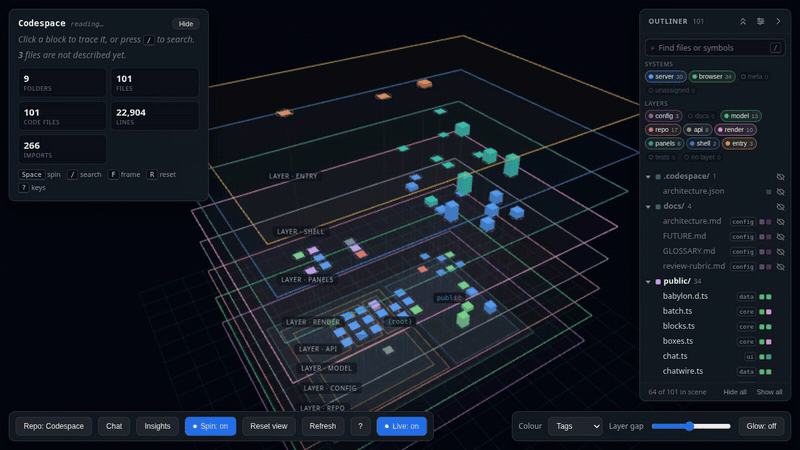
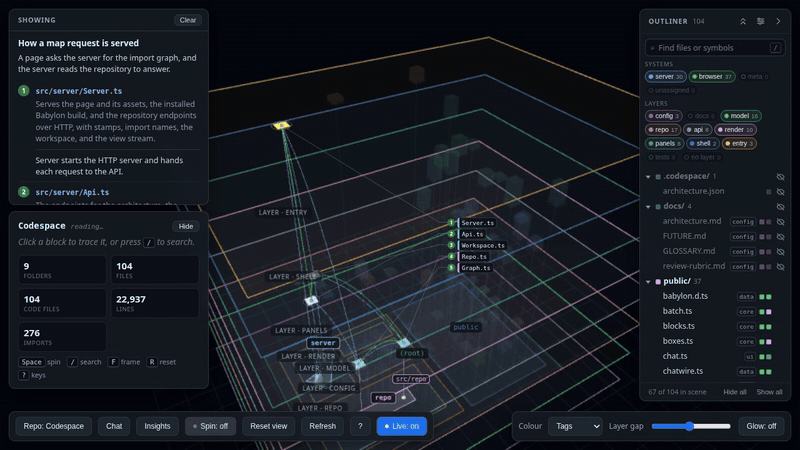
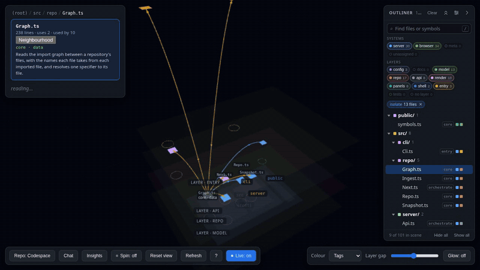

# Codespace

Codespace draws a repository as a small 3D city. Each file is a box, each folder is a district, and the imports between files are drawn as wires. Files sit on layers, such as `model`, `api`, and `render`, so you can see at a glance when an import reaches up the stack. A built-in chat agent can answer questions about the code and draw its answer on the map as a numbered route.



```sh
npm install
npm start -- --repo /path/to/repo    # then open http://localhost:5190
```

An agent can describe the repository for the map with the CLI. After that, the agent can put things on the map with one HTTP call. For example, this call traces how a request is served:

```sh
curl -s -X POST localhost:5190/api/view -H 'Content-Type: application/json' -d '{
  "action": "show", "trace": true, "title": "How a map request is served",
  "files": [{"path": "src/server/Server.ts", "note": "Starts the HTTP server."},
            {"path": "src/server/Api.ts",    "note": "Routes GET /api/graph."},
            {"path": "src/repo/Graph.ts",    "note": "Reads the import edges."}]}'
```



When you choose a file, the map opens it into a stack of floors, with one floor for each function or class. The Neighbourhood button then hides every file except the file's imports and the files that import it. Node 22.19 or newer is required. See [`AGENTS.md`](AGENTS.md) for the CLI, the full HTTP API, and the chat setup.



An **Insights** panel in the bottom bar lists the files changed since HEAD, keeps saved views of the map (flows) and a start-here tour, and reports the codebase's size, layer breaks, largest files, undescribed files, and key-shaped values.
